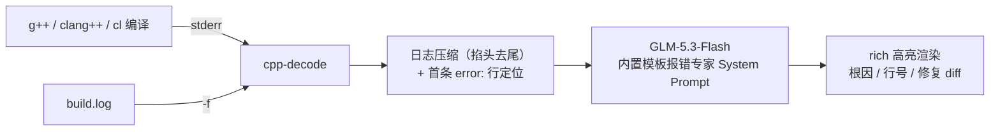

<div align="center">

# 🩺 cpp-template-error-decoder

**把几千行 C++ 模板“天书”报错，翻译成 3 句人话 + 行号 + 修复 diff**

[](https://pypi.org/project/cpp-template-error-decoder/)
[](https://www.python.org/)
[](LICENSE)
[](https://github.com/psf/black)
[](https://open.bigmodel.cn/)

一行管道命令，让 [GLM-5.3-Flash](https://open.bigmodel.cn/) 穿透 GCC / Clang / MSVC
模板实例化的层层噪音，直接告诉你：**哪里错了、为什么错、怎么改**。

`g++ main.cpp 2>&1 | cpp-decode`

</div>

---

## ✨ 效果对比

### 🤯 Before：编译器吐给你的（节选自 200+ 行报错）

```text
/usr/include/c++/11/bits/stl_function.h: In instantiation of
'constexpr bool std::less<_Tp>::operator()(const _Tp&, const _Tp&) const [with _Tp = Node]':
/usr/include/c++/11/bits/stl_tree.h:1965:32:   required from
'std::pair<std::_Rb_tree_iterator<_Val>, bool> std::_Rb_tree<_Key, _Val, _KeyOfValue,
_Compare, _Alloc>::_M_insert_unique(_Arg&&) [with _Arg = const value_type&; ...]'
/usr/include/c++/11/bits/stl_map.h:508:32:   required from
'std::map<_Key, _Tp, _Compare, _Alloc>::mapped_type& std::map<_Key, _Tp, _Compare,
_Alloc>::operator[](const key_type&) [with _Key = Node; _Tp = int; ...]'
main.cpp:13:12:   required from here
/usr/include/c++/11/bits/stl_function.h:408:20: error: no match for 'operator<'
(operand types are 'const Node' and 'const Node')
  408 |       { return __x < __y; }
      |               ~~~~~^~~~~
```

### 🩺 After：`cpp-decode` 输出的（终端中为 rich 彩色高亮面板）

```text
🎯 已捕获第一条错误行：/usr/include/c++/11/bits/stl_function.h:408:20: error: no match for 'operator<' ...

┌── 🧨 根本原因 ──────────────────────────────────────────────
│ std::map 需要比较 key，而你的 Node 结构体没有定义 operator<。
│ map 底层的红黑树（std::_Rb_tree）插入时会对两个 Node 调用 operator<。
│ 补上比较运算符或提供比较器即可。
└─────────────────────────────────────────────────────────────
┌── 📍 错误代码位置 ──────────────────────────────────────────
│ 文件: main.cpp    行号: 12
│
│ std::map<Node, int> scores;
└─────────────────────────────────────────────────────────────
┌── 🛠️ 推荐修复方案 ──────────────────────────────────────────
│ 给 Node 重载 operator<，让红黑树可以比较两个节点：
│
│ + bool operator<(const Node& a, const Node& b) { return a.id < b.id; }
└─────────────────────────────────────────────────────────────
```

## 🧠 工作原理



内置的 System Prompt 专门训练了对以下高频模板报错模式的识别：

| 编译器报错特征 | 真实根因（工具会点名） |
| --- | --- |
| `no match for 'operator<'` + `_Rb_tree` / `std::map` / `std::set` | 自定义 key 类型缺少 `operator<` 或比较器 |
| `no matching function for call to 'std::vector<...>::push_back(...)'` | 元素类型与容器声明类型不匹配 |
| `no match for 'operator=='` + `std::find` | 元素类型缺少 `operator==`，或应改用容器成员 `find()` |
| `template argument deduction/substitution failed` | SFINAE 静默淘汰了所有候选重载（`enable_if` 条件不满足） |
| `constraints not satisfied` / MSVC `C2676` + concept | 指出具体哪个 concept 的哪个原子约束为 false |
| `no type named 'type' in 'struct std::enable_if<false, ...>'` | trait 探测失败，缺失嵌套类型 / 别名 |
| `use of deleted function` | const / 引用 / `unique_ptr` 成员导致拷贝或移动构造被删除 |
| `type/value mismatch at argument N` | 模板实参个数或类型不匹配 |
| `undefined reference to ...` | 模板定义未放头文件，或缺少显式实例化 |

## 📦 Installation

```bash
# 从源码安装（推荐放入虚拟环境）
git clone https://github.com/your-name/cpp-template-error-decoder.git
cd cpp-template-error-decoder
pip install .

# 或者使用 pipx 隔离安装为全局命令
pipx install .
```

## ⚡ Quick Start

**第 1 步：配置智谱 API Key**（[免费申请](https://open.bigmodel.cn/)）

```bash
# Linux / macOS
export ZHIPUAI_API_KEY="你的Key"

# Windows PowerShell
$env:ZHIPUAI_API_KEY = "你的Key"
```

**第 2 步：解码报错**

```bash
# 管道模式：编译输出直接喂进来
g++ main.cpp 2>&1 | cpp-decode
clang++ -std=c++20 main.cpp 2>&1 | cpp-decode
cl /std:c++20 /EHsc main.cpp 2>&1 | cpp-decode

# 文件模式：先重定向再分析，也支持 CI 里分析现成的 build.log
g++ main.cpp 2> build.log
cpp-decode -f build.log

# 不要彩色面板，输出纯 Markdown（方便二次处理 / 保存）
g++ main.cpp 2>&1 | cpp-decode --raw > report.md
```

**全部选项**

| 选项 | 说明 | 默认值 |
| --- | --- | --- |
| `-f, --file <path>` | 读取编译日志文件（缺省从管道读取 stdin） | — |
| `--model <name>` | 智谱 GLM 模型名 | `glm-5.3-flash` |
| `--api-key <key>` | API Key（也可用环境变量 `ZHIPUAI_API_KEY`） | 读环境变量 |
| `--max-chars <n>` | 送入 LLM 的日志最大字符数，超长自动掐头去尾 | `12000` |
| `--raw` | 输出原始 Markdown，不渲染富文本面板 | 关闭 |
| `-V, --version` | 查看版本 | — |
| `-h, --help` | 查看帮助 | — |

## 🧩 项目结构

```
cpp-template-error-decoder/
├── cpp_decoder/
│   ├── llm.py          # GLM-5.3-Flash 调用核心 + 模板报错专家 System Prompt
│   ├── formatter.py    # rich 面板渲染：根因 / 行号 / 修复 diff
│   └── cli.py          # cpp-decode 命令行入口（管道 / -f 文件）
├── tests/
│   └── test_decoder.py # pytest：两段真实模板报错 + 模拟解码（离线运行）
├── pyproject.toml
├── README.md
├── LICENSE
└── .gitignore
```

## 🛠️ Development

```bash
pip install -e ".[dev]"
pytest            # 全部测试离线运行，不消耗 API 额度
```

## 🔒 隐私说明

`cpp-decode` 只会把**编译器输出文本**（含报错上下文中的源码片段）发送给你自己
配置的智谱 API Key 对应的服务，不经过任何第三方服务器；不上传整个源码文件。

## ❓ FAQ

**Q: 换成其他模型可以吗？**
A: 可以。`cpp-decode --model glm-4-flash` 即可切换智谱系模型；SDK 层面同样兼容智谱开放平台的其他对话模型。

**Q: 几千行日志会全部发给模型吗？**
A: 不会。默认压缩到 12000 字符（保留前 60% 与后 40%，中间省略），根因几乎总在首尾；可用 `--max-chars` 调整。

**Q: 报错全是英文，输出是中文吗？**
A: 是。诊断报告用中文输出，代码、类型名与报错关键词保留英文原文。

## 🗺️ Roadmap

- [ ] `--watch` 模式：监听编译命令，出错自动解码
- [ ] CMake / xmake / Meson 构建日志适配
- [ ] 多轮追问：`cpp-decode --chat` 针对报告继续提问
- [ ] 支持 OpenAI 兼容端点（vLLM / Ollama 本地模型）

## 🤝 Contributing

欢迎 Issue 与 PR！提交前请运行 `pytest` 确保测试通过。

## 📄 License

[MIT](LICENSE) © 2026 cpp-template-error-decoder contributors
